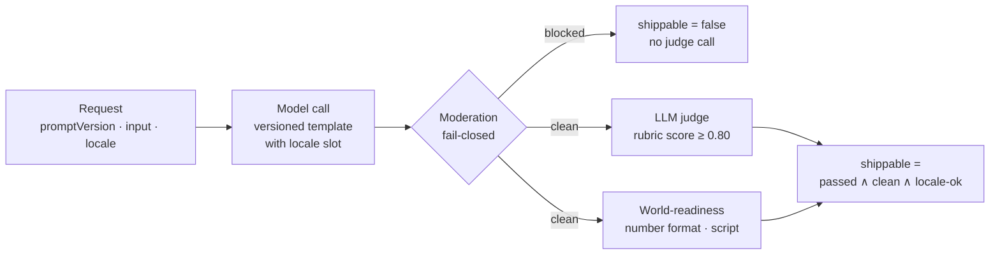

# Multilingual GenAI Gateway

**A TypeScript gateway that runs versioned prompts and returns a single `shippable` bit per locale — combining an LLM-as-judge score, a fail-closed moderation pass, and deterministic locale checks — so prompt changes can be gated in CI across languages.**

A prompt that works in `en-US` tells you very little about `ja-JP` or `ar-EG`. This gateway is the choke point that every team's prompt goes through: it runs the model, refuses to grade anything moderation blocks, scores the answer against a rubric, checks it actually follows the target locale's conventions, and judges a prompt version by its *worst* locale rather than its average.



## Design choices

- **Versions, not raw prompts.** Callers send a prompt version like `support-reply@v7`; templates are resolved server-side and carry `{{input}}` and `{{locale}}` slots, so every output is traceable to an immutable prompt.
- **Moderate before judging.** A blocked answer is never shippable, so the gateway skips the judge call entirely. If the moderation call errors or returns unparseable output, the result is treated as blocked (`moderation-error`).
- **Rubric-based judging.** The judge scores 0–1 against what a correct answer must contain, not an exact string, because good answers vary in wording. The pass bar is 0.80.
- **Deterministic locale checks.** World-readiness is checked in code, not by another model: number grouping must match `Intl.NumberFormat` for the locale, and answers for Arabic, Hebrew, Persian, Urdu, Japanese, Chinese, Korean, and Russian locales must contain non-Latin script.
- **Worst locale wins.** The CI gate runs every golden case across `en-US`, `ja-JP`, `ar-EG`, and `de-DE`, prints a per-locale line, and exits non-zero if any locale is below 0.80 or not shippable.

## CI gate

```bash
PROMPT_VERSION=support-reply@v7 npx tsx scripts/ci-gate.ts
```

It prints one line per golden case and locale, in the form `<ok|FAIL>  <locale>  <score>  "<first 30 chars of input>"`. A locale can score above the floor and still `FAIL` when moderation or a locale check fails — see [RUNBOOK.md](RUNBOOK.md) for how to read and act on a red locale.

## Layout

| Path | Purpose |
|---|---|
| `src/gateway/` | Request/response types, the model runner, and `handle()` |
| `src/eval/judge.ts` | Golden-case type and rubric judge |
| `src/eval/multilingual.ts` | Per-locale matrix and `worstLocale` |
| `src/moderation/moderate.ts` | Policy classifier (harassment, self-harm, private data, off-brand), fail-closed |
| `src/i18n/worldReady.ts` | Number-format and script checks |
| `scripts/ci-gate.ts` | The merge gate |

## Status and limitations

The gateway logic and CI gate are written; the pieces they plug into are not in the repository:

- **Missing modules:** `src/model/client` (`callModel`), `src/prompts/registry` (`resolvePromptVersion`), and `src/eval/golden` (`GOLDEN`). There's also no `package.json` or `tsconfig.json`, so the gate can't run yet.
- **No Postgres or ICU dependency in code yet.** Locale handling uses the built-in `Intl` API, and nothing is persisted.
- **The number-format check is a coarse proxy.** It looks for the locale's grouping separator anywhere in the text, so a correct non-US answer that contains no numbers fails the check (verified for `ja-JP`). Checking only when digits are present would fix that.
- The judge's JSON is parsed without validation; a malformed judge response throws rather than failing closed like moderation does.
